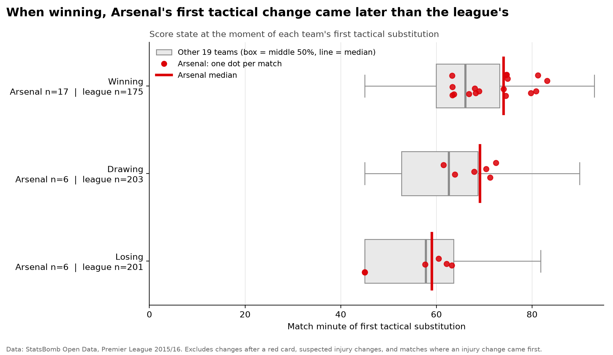
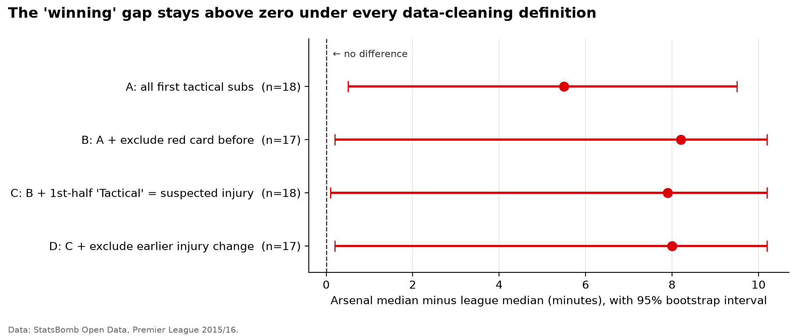
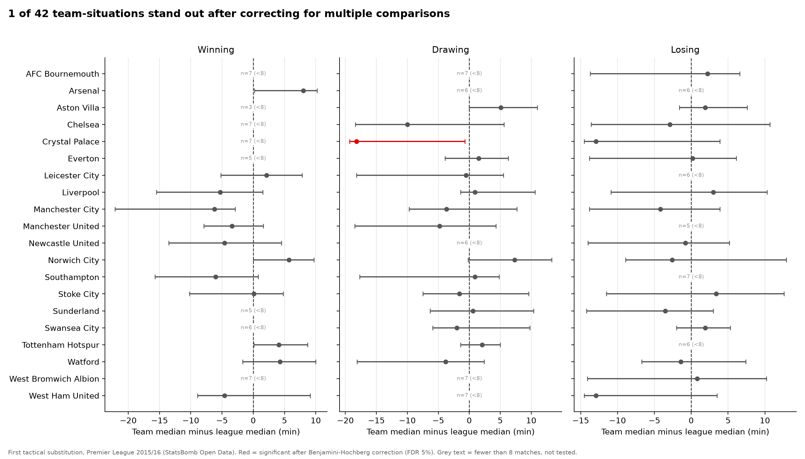
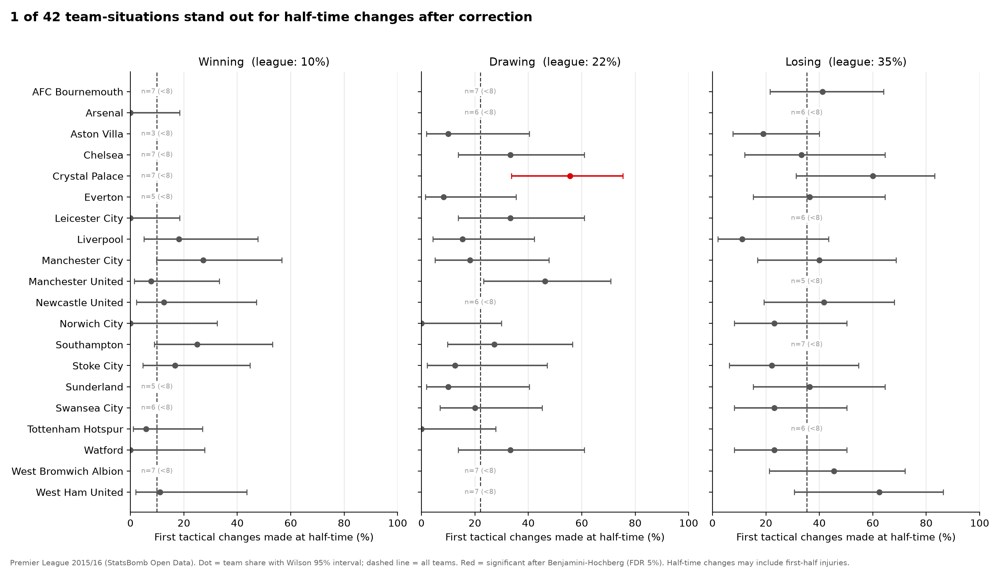

# Football Tactical Intelligence

Identifying, quantifying and comparing football managers' **observable** tactical decisions, starting with substitutions, using public event data, transparent statistics and (later) carefully validated machine learning.

> **Status:** Phase 1 complete (v0.1.0): tested one-command pipeline, first finding, robustness checks and charts. See [PROGRESS.md](PROGRESS.md).

## Motivation

This project started with a fan's question. In October 2026, Bop Daddy
([@awoyemijoshua61](https://x.com/awoyemijoshua61/status/2113682215250854396))
asked whether Mikel Arteta's Arsenal were deliberately managing energy:
controlled first halves, fresh legs and triple substitutions in the final
30 minutes, and holding a higher line after taking the lead, while
clearly separating what he observed from what he suspected.

Questions like this are usually argued from memory and impressions. This
project builds the tools to test them with event data: what managers
actually do, in which game situations, and how confident we can be.

Detailed current-season event data is costly, so the methods are developed
and validated on free StatsBomb Open Data for the 2015/16 Premier League
(Wenger's Arsenal and 19 other clubs). The same pipeline can be re-run on
newer data if it becomes available. Note that substitution rules differ:
3 changes per team in 2015/16 versus 5 today.

## Research question (MVP)

> In the 2015/16 Premier League, how did the timing of Arsenal's first substitution vary by score state (winning / drawing / losing) at the moment of the change, and how does that compare with the league-wide distribution?

Scope and principles:
- **Sample:** all 38 Arsenal league matches of 2015/16 (Arsène Wenger), benchmarked against all 380 matches of the same season.
- **Observed facts vs. interpretation:** the project reports what the data shows (who, when, at what score). It does not claim to know a manager's intentions, and makes no causal claims ("this substitution won the game") without a defensible causal design.
- **Tactical vs. injury substitutions** are analysed separately where the data distinguishes them.
- Small samples are reported with uncertainty intervals, not as precise facts.

## Key finding (Arsenal, 2015/16)

**When Arsenal were winning, their first tactical substitution came about 6-8 minutes later than other Premier League teams' in the same situation.**



| | Result |
|---|---|
| Gap when winning (Arsenal - rest of league, median) | **+8.0 min**, 95% bootstrap CI +0.2 to +10.2 (n = 17 vs 175) |
| Permutation test (10,000 label shuffles) | p = 0.010 (below Bonferroni threshold 0.05/3 for three score states) |
| Within lead size | +7.1 min ahead by 1 goal (n = 8), +6.2 min ahead by 2+ (n = 9) |
| When drawing / losing | No reliable difference (p = 0.22 / 0.83) |

**Robustness.** The gap stays above zero under every data-cleaning definition, and grows slightly once messy cases are removed:



**Interpretation.** Suggestive, not conclusive. This is an observed pattern in one season, consistent with (for example) reluctance to disturb a winning side, but the data cannot show *why* it happened.

## League-wide comparison (all 20 teams)

The same measure for every team, compared with the rest of the league in each score state
(`python -m fti --skip-ingest --league`). Up to 60 questions are asked at once, so p-values are
corrected with **Benjamini-Hochberg** (false discovery rate 5%). Team-situations with fewer than
**8 matches** are not tested; this minimum was fixed before the results were seen.



- **42 of 60** team-situations had enough matches to test (weaker teams were rarely winning,
  stronger teams rarely losing).
- **One result survives correction: Crystal Palace when drawing** (p = 0.0006, adjusted p = 0.025;
  also passes Bonferroni). Inspecting the matches shows *why*: Palace made their first tactical change
  **at half-time in 10 of 18** drawn situations, spread across the whole season.
- **Arsenal's winning-state result ranks 2nd of 42 but does not survive** league-wide correction
  (adjusted p = 0.21). It remains a pre-chosen case study, not a league-wide standout.
- "Team" is not the same as "manager": six clubs changed manager during 2015/16.

### Half-time changes

StatsBomb records half-time substitutions at the start of the second half (45:00), so the share of
first tactical changes made at the interval can be measured directly.

| Score state at the change | Share made at half-time (all teams) |
|---|---|
| Winning | 10% |
| Drawing | 22% |
| Losing | **35%** |

Across the league, **23% of first tactical changes (138 of 608) were made at half-time**, and managers
who were losing were about **3.5 times as likely** to change at the interval as those who were winning.
This league-wide pattern is descriptive (not yet formally tested), but rests on all 608 changes.



- **Crystal Palace** made their first change at half-time in **10 of 18** drawn situations (56% vs 19%
  for the rest of the league; adjusted p = 0.025) and in 16 of 35 overall, the highest in the league.
  This is the same evidence as the timing result above, expressed as a proportion, not a second confirmation.
- No other team stands out after correction (next smallest: Manchester United when drawing, 46%,
  adjusted p = 0.79).
- Caveat: a first-half injury replaced at the interval also counts as a half-time change.


## Method in brief

1. **Score at each substitution:** goals (incl. own goals) counted strictly before each change, using StatsBomb's event order. Validated: reproduces all 380 official final scores.
2. **First tactical substitution** per team per match, as a decimal match clock.
3. **Cleaning (main definition, "variant D"):** exclude matches with a red card before the change; treat first-half changes labelled "Tactical" as suspected injuries; exclude matches where an injury change came first. Variants A-D are reported side by side.
4. **Uncertainty:** median with 95% percentile-bootstrap intervals (10,000 resamples), bootstrap CI for the Arsenal-league difference, and a permutation test as a second opinion.

## Limitations

- **One season, one team, small samples.** 17 Arsenal matches in the winning state; subgroups (8-9 matches) are too small to stand alone.
- **Observational, not causal.** No claim that later substitutions helped or hurt results, and no claim about the manager's intentions.
- **Label quality.** StatsBomb sometimes labels injury changes as "Tactical" (e.g. Koscielny, 11' v Norwich, 29 Nov 2015). The first-half rule is a transparent heuristic and will occasionally misclassify genuine early tactical changes.
- **Timing and score state are entangled.** Every match starts level, so early changes are mostly made while drawing. Comparing within the same score state reduces, but does not remove, this. A survival (time-to-event) model is a planned improvement.
- **Uncontrolled confounders.** Opponent strength, home/away, fixture congestion and squad availability are not yet adjusted for. Winning margin was checked and does not explain the gap.
- **Multiple comparisons.** Three score states and four cleaning variants were examined. The winning-state gap appeared in the first, uncleaned analysis and is reported because it held in every variant; isolated hits (e.g. drawing under variant D, n = 6) are treated as noise.
- **Half-time injuries are invisible.** StatsBomb records half-time changes at the start of the second half, so a player injured in the first half and replaced at the interval looks like a tactical half-time change. The first-half suspected-injury rule cannot catch these.
- **Focus team chosen in advance.** Arsenal was selected as the case study before any analysis, which is why a per-team correction (0.05 / 3 score states) is used for its result. Scanning all 20 teams for standouts is a different question that requires a stricter league-wide correction (planned for Phase 2); under that correction, a p-value like Arsenal's 0.010 would not stand out on its own.
- **Benchmark mix.** "Rest of league" pools 19 other clubs and their managers (including mid-season managerial changes).

## Data

Data: **StatsBomb Open Data** (Hudl StatsBomb), 2015/16 Premier League, accessed via the official [`statsbombpy`](https://github.com/statsbomb/statsbombpy) package.

- Use is subject to the [StatsBomb Open Data user agreement](https://github.com/statsbomb/open-data). Raw StatsBomb data is **not** redistributed in this repository; it is downloaded at runtime.
- Field definitions and conventions: [docs/data_dictionary.md](docs/data_dictionary.md).

<!-- TODO: add the StatsBomb logo from their media pack, as the open-data terms request. -->

## Reproduce

Requires Python 3.12 (Windows commands shown).

```powershell
python -m venv .venv
.\.venv\Scripts\Activate.ps1
python -m pip install -r requirements.txt

# Phase 0 checks
python scripts\check_data_coverage.py      # confirms 380 matches / 38 Arsenal matches
python scripts\inspect_substitutions.py    # sample substitution + goal records

# Whole pipeline in one command (Arsenal by default)
python -m fti                 # ingest -> substitutions -> first_sub -> robustness -> charts
python -m pytest -v           # run tests

# Any other team (results go to results/<team>/, e.g. results/leicester-city/)
python -m fti --list-teams
python -m fti --skip-ingest --team "Leicester City"

# All 20 teams compared: timing + half-time rate (results/league/)
python -m fti --skip-ingest --league

# ...or step by step
python -m fti.ingest          # download + cache all 380 matches (one-off, ~1.2 GB local)
python -m fti.substitutions   # score at every substitution -> data/processed/substitutions.csv
python -m fti.first_sub       # timing by score state + sensitivity variants -> results/<team>/
python -m fti.robustness      # winning-margin split + permutation tests -> results/<team>/
python -m fti.charts          # figures -> results/<team>/figures/  (each accepts --team)
python -m pytest -v           # run tests
```

## Project structure

```
football-tactical-intelligence/
├── docs/data_dictionary.md   # fields, definitions, conventions
├── fti/                      # reusable package: ingestion, substitution analytics, charts
├── results/<team>/           # per-team result tables and figures (no raw data)
├── tests/                    # automated tests
├── scripts/                  # Phase 0 feasibility checks
├── PROGRESS.md               # progress log and next steps
├── requirements.txt          # pinned dependencies
└── README.md
```

## Roadmap

0. Feasibility & setup (done)
1. Reproducible Arsenal substitution analytics (done, v0.1.0)
2. Manager comparisons across the league; careful ML only where justified
3. Automated short analysis videos from the same pipeline
4. Portfolio polish
